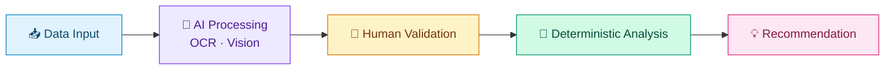
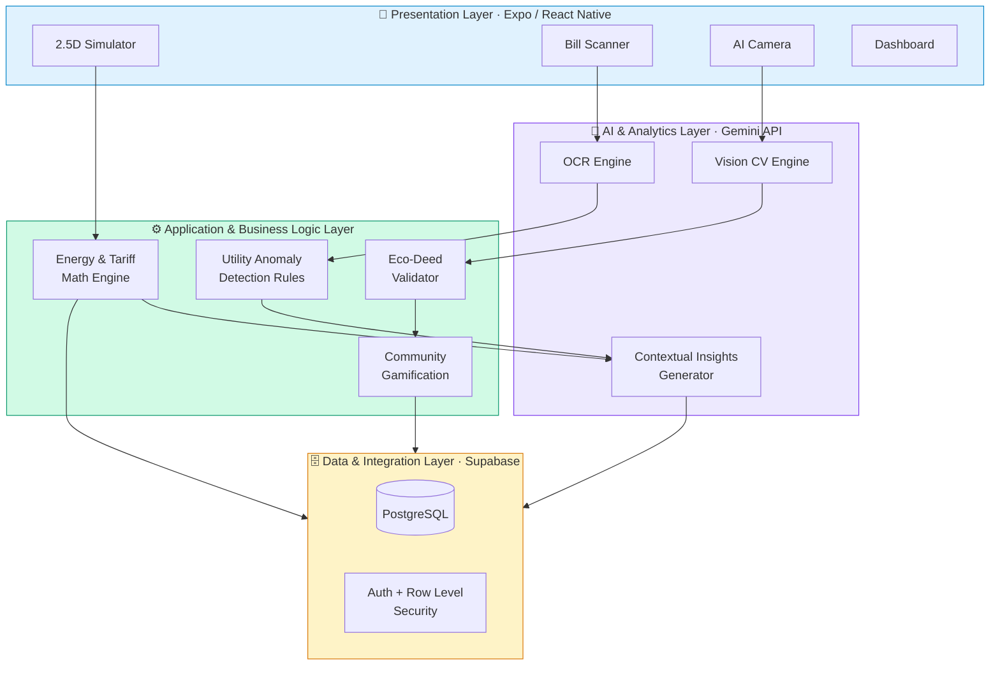
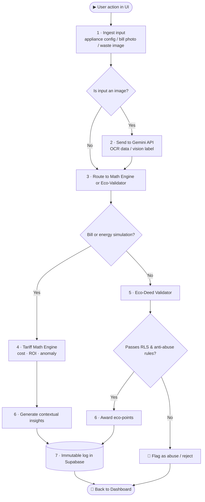

<div align="center">


### 🌱 *Understand · Respond · Learn*
**Turn everyday household habits into real savings, cleaner recycling, and community rewards.**

<br/>


<br/>

[✨ Features](#-five-core-capabilities) · [❓ The Problem](#-the-problem) · [🧠 AI Strategy](#-ai-strategy-ai-guesses-math-decides) · [🏗 Architecture](#-architecture) · [🗺 Roadmap](#-roadmap) · [👥 Team](#-team)

</div>

---

## 💡 What is Simeplify?

> Household sustainability today is a **black box**. People *want* to be eco-friendly, but their energy data is lagging, their recycling bins are "dumb", and going green feels like **all friction and no reward**.

**Simeplify** fuses four things that are normally scattered across separate apps into **one platform**:

<table>
<tr>
<td align="center" width="25%">⚡<br/><b>Energy simulation</b><br/><sub>See what each appliance really costs</sub></td>
<td align="center" width="25%">🧾<br/><b>Bill intelligence</b><br/><sub>Scan bills, spot abnormal usage early</sub></td>
<td align="center" width="25%">♻️<br/><b>AI waste guidance</b><br/><sub>Point your camera, sort it right</sub></td>
<td align="center" width="25%">🏆<br/><b>Community rewards</b><br/><sub>Eco-points, challenges, shared voting</sub></td>
</tr>
</table>

It combines **AI** (for messy, unstructured inputs) with **deterministic calculations** (for anything involving money), so every recommendation is both smart *and* trustworthy.

---

## ❓ The Problem

<div align="center">

| 🔢 | **Stat** | **Why it matters** |
|:--:|:--|:--|
| **37.9%** | Malaysia's 2024 recycling rate | Below the national target |
| **~40%** | Household waste that is recyclable | Yet much still ends up in landfills through cross-contamination |
| **~50%** | Households that don't know how to sort waste correctly | Fuels "wishcycling" that ruins whole batches |
| **85%** | Malaysians who see saving energy as the *utility's* job | A motivation and ownership deficit |
| **72%** | Consumers who stick to basic habits instead of upgrading | They can't calculate personal ROI |
| **RM18.56** | Monthly saving from manual habits on a 677 kWh bill | Inverter ACs cut power use by **30–50%** |

</div>

<details>
<summary><b>🔍 Four gaps we are closing (click to expand)</b></summary>

<br/>

| Real-world experience | Infrastructure gap | Simeplify's answer |
|:--|:--|:--|
| Phantom loads and silent leaks go unnoticed for months | Meters only show cumulative, lagging totals | **Scanner** compares billing history and flags anomalies |
| "Is solar or a 5-star appliance worth it for *me*?" | No personalised ROI "energy sandbox" | **Simulator** with appliance swap and solar guidance |
| "Is a greasy pizza box recyclable?" | Community bins have no point-of-disposal guidance | **Recycle Bin** with AI vision classification |
| Eco-living feels lonely and unrewarded | Utility and recycling data sit in separate silos | **Community** and **Dashboard** in one place |

</details>

---

## ✨ Five Core Capabilities

### ⚡ 1. Energy Simulator
Drag and drop appliances onto an interactive **2.5D floor plan** and watch your estimated monthly electricity cost update in real time.
- Configure rooms, appliances, power ratings and daily usage routines
- Tariff-aware cost estimation (WYSIWYG, no spreadsheets needed)
- **Appliance Swap & Compare** with 1–12 month savings projections
- Preliminary **solar suitability** guidance based on transparent, rule-based triggers

### 🧾 2. AI-Powered Utility Bill Scanner
Snap a photo of an electricity or water bill and let OCR do the typing.
- Extracts consumption, billing period and amount
- Stores history and **separates usage (kWh / m³) from money (RM)**, so tariff changes are never mistaken for consumption changes
- Flags unusual spikes and suggests follow-up checks, such as *"consider checking for a possible leak"*
- Compares **Estimated vs. Actual** against the Simulator

### ♻️ 3. Intelligent Recycle Bin
Point the camera at an item and get instant disposal guidance mapped to Malaysia's four-stream system.

<div align="center">


</div>

- Vision-based classification via the Gemini API
- Blurry or uncertain? It **asks you to verify manually** instead of guessing
- Daily eco-deed tracking with **anti-abuse verification** rules

### 🏆 4. Gamified Community Engagement
- Household **eco-points** earned from verified recycling events
- Monthly environmental challenges and contribution summaries
- **Collective reward voting**, so the community decides what rewards it unlocks
- Transparent, auditable point rules

### 📊 5. Unified Household Dashboard
One home for appliance configs, estimated costs, bill history, consumption trends and eco-contributions, with estimated and actual data **always clearly labelled**.

---

## 🧠 AI Strategy: *AI guesses, math decides*

Simeplify never lets AI touch the money. AI handles perception; deterministic code handles decisions.



| AI use case | Module | Technique |
|:--|:--|:--|
| Intelligent bill scanning | Scanner | OCR & document understanding |
| Waste identification | Recycle Bin | Computer vision (Gemini API) |
| Anomaly detection | Scanner & Simulator | Statistical analysis & hybrid thresholds |
| Personalised recommendations | Integrated engine | Context-grounded AI + business rules |

**🎯 Validation targets**

| Target | Metric |
|:--|:--|
| 🧾 Bill OCR key fields | **≥ 90%** accuracy |
| ♻️ Waste image classification | **≥ 85%** accuracy on a labelled dataset |

**🛡 Responsible AI:** explicit user consent before processing images or bills · data minimisation · alerts are *indicators for investigation*, never definitive diagnoses or guaranteed financial forecasts.

---

## 🏗 Architecture

A modular **four-layer** design keeps AI processing cleanly separated from business rules.



### 🔄 Operational lifecycle: *Understand → Respond → Learn*



### 🗃 Core data model

| Domain | Entities | Purpose |
|:--|:--|:--|
| 🏠 Identity & Context | `User` · `Household` · `Room` | Maps users to households and room layouts |
| ⚡ Energy Modeling | `Appliance` · `Usage Schedule` | Power ratings and daily routines |
| 🧾 Utility Tracking | `Utility Bill` · `Utility Reading` | Separates **money** from **physical usage** |
| ♻️ Waste | `Waste Scan Logs` | AI classification attempts |
| 🏆 Gamification | `Recycling Event` · `Eco-Point Transaction` · `Poll & Reward` | Auditable, immutable points and votes |

### 🔐 Security & privacy
- **Supabase Auth + Row Level Security (RLS)**: users only see their own household data
- Role-based access for residents and administrators
- Sensitive metrics are hidden from public community views
- Graceful fallbacks: low-confidence AI results prompt manual entry

---

## 🛠 Tech Stack

<div align="center">

| Layer | Technology |
|:--:|:--|
| 📱 Frontend | Expo · React Native |
| 🗄 Backend | Supabase (PostgreSQL, Auth, RLS) |
| 🤖 AI | Gemini API (unified OCR + vision) |
| 🧮 Logic | Deterministic tariff, ROI and eco-point rule engines |

</div>

> **Why one Vision-Language Model?** Instead of juggling separate legacy models for document parsing and image recognition, a single Gemini integration handles both, which cuts architectural complexity and keeps the build realistic for a hackathon.

---

## 🧪 Validation Approach

| ID | Problem | Verified by |
|:--:|:--|:--|
| **P1** | Unclear how usage affects the bill | Costs checked against reference calculations for known appliance ratings |
| **P2** | Hard to judge upgrade / solar ROI | Savings use consistent assumptions; solar triggers match predefined rules |
| **P3** | Confusion over waste categories | AI accuracy evaluated on a labelled dataset |
| **P4** | Low recycling motivation | Point rules, activity recording and voting logic validated |
| **P5** | Bill shocks and delayed detection | Extracted data compared with manual input; spike alerts verified |
| **P6** | Fragmented records | Secure retrieval confirmed; access restricted to authorised users |

---

## 🗺 Roadmap

```mermaid
gantt
    title Hackathon Timeline
    dateFormat  X
    axisFormat  %s
    section Build
    Phase 1 · Core Setup (data model, UI, onboarding)      :a1, 0, 1
    Phase 2 · Functionality (simulator math, bill records) :a2, 1, 2
    Phase 3 · AI Integration (Gemini OCR + vision)         :a3, 2, 3
    Phase 4 · Testing & Demo                               :a4, 3, 4
```



| | ✅ MVP (Hackathon) | 🚀 Future |
|:--|:--|:--|
| ⚡ Energy | Electricity cost calculation, appliance swap comparison | Smarter solar sizing |
| 🧾 Bills | OCR bill extraction, rule-based alerts | ML-based predictive anomaly detection |
| ♻️ Waste | Basic image-based waste ID | **Real IoT smart-bin** deployment, route optimisation |
| 🏆 Community | Simulated eco-points | Live commercial reward partnerships |

---

## 🚀 Getting Started

> ⚠️ Replace the placeholders below with your actual repo details.

```bash
# 1. Clone
git clone https://github.com/<your-org>/simeplify.git
cd simeplify

# 2. Install dependencies
npm install

# 3. Configure environment
cp .env.example .env
# EXPO_PUBLIC_SUPABASE_URL=...
# EXPO_PUBLIC_SUPABASE_ANON_KEY=...
# GEMINI_API_KEY=...
# GEMINI_API_KEY_BACKUP=...
# GEMINI_MODEL=gemini-3.6-flash

# 4. Run
npx expo start
```

---

## 👥 Team

<div align="center">

**Universiti Teknologi Malaysia · Faculty of Computing · Year 3**

| | Name | Major | Role |
|:--:|:--|:--|:--|
| 👑 | **Hong Jia Bao** | Data Engineering | Team Leader |
| 🛡 | **Edwin Oo Ming Hao** | Computer Network & Security | Team Member |
| 📊 | **Lee Pei Yuan** | Data Engineering | Team Member |
| 🔐 | **Yeoh Keng Wei** | Computer Network & Security | Team Member |

</div>

---

## 📚 References

<details>
<summary>Sources cited in our proposal</summary>

<br/>

- Asia News Network (2024). *Malaysia's national recycling rate reaches 37.9%.*
- Dzulkifli, S. (2026). *40% of Malaysia's trash is recyclable.* Asia News Network.
- Choon, S. W., Tan, S. H., & Chong, L. L. (2017). The perception of households about solid waste management issues in Malaysia. *Environment, Development and Sustainability, 19*(5), 1685–1700.
- EY (2024). *Energy consumers in Malaysia are confident about their energy future, but are not taking further action.*
- Lee, B. (2025). *Surge in recycling drowned out by rising tide of trash.* The Star.
- Mahavera, S., & Lai, A. (2025). *Fewer leaks, smoother flow.* The Star.
- Purushotman, J. (2024). *Air Selangor moves to find solution to water issues.* The Sun.
- Smart Energy Consumer Collaborative (2025). *Building awareness and trust with Gen Z* [White paper].
- Suruhanjaya Tenaga. *Energy efficiency and saving guidelines for residential sector*; *Guide to saving electricity.*

</details>

---

<div align="center">

**Made with 💚 for a greener, simpler home.**

<sub>Simeplify · Hackathon MVP · Universiti Teknologi Malaysia</sub>


</div>
