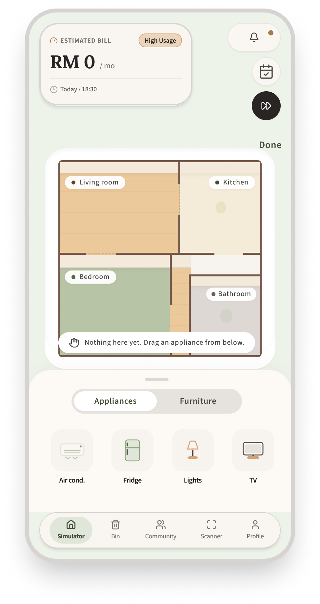
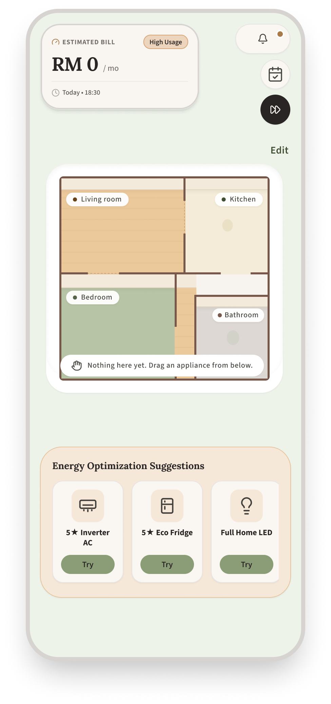
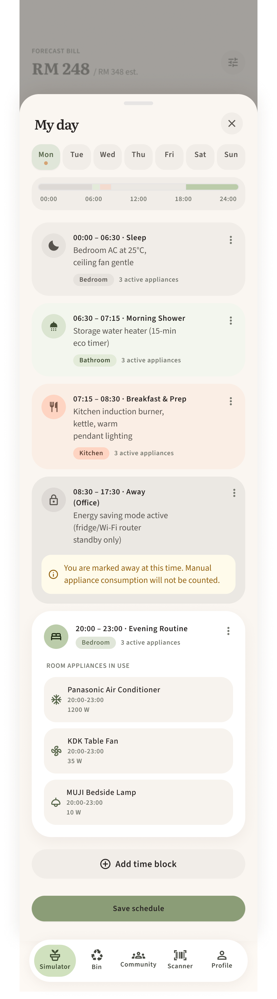
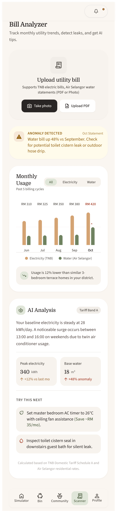
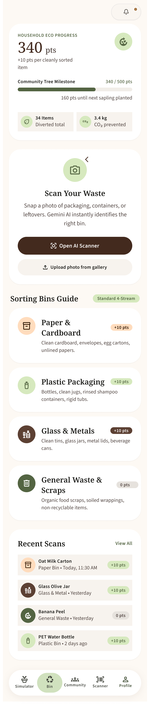
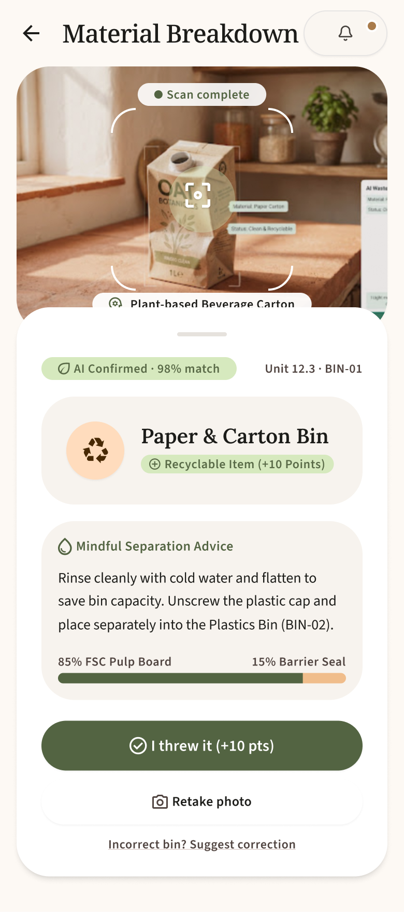
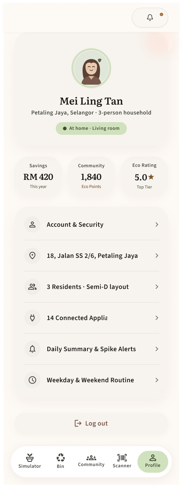
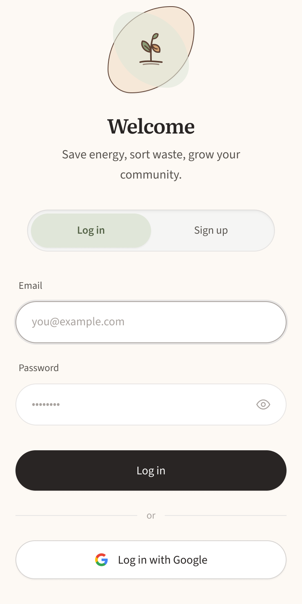

# Simeplify 🌿

> **AI-Powered Digital Twin & Eco-Habit Assistant for Smart Malaysian Homes**

[](https://github.com/HONGJIABAO/Simeplify/actions/workflows/deploy-pages.yml)
[](https://hongjiabao.github.io/Simeplify/testing-kwei)
[](https://expo.dev/)
[](https://necolas.github.io/react-native-web/)
[](https://www.typescriptlang.org/)
[](https://supabase.com/)
[](https://ai.google.dev/)

---

## 🌐 Live Website (GitHub Pages)

Experience the live, interactive web application running directly on GitHub Pages for the **`testing-kwei`** branch:

🔗 **[https://hongjiabao.github.io/Simeplify/testing-kwei](https://hongjiabao.github.io/Simeplify/testing-kwei)**

*Tip: For testing without signing up, use the pre-seeded demo account (`meiling.tan@example.com` / `password123`) or register a new household.*

---

## 📌 Branch Highlights (`testing-kwei`)

This branch contains key feature completions, UI enhancements, and deployment infrastructure:

- 🌐 **Branch-Specific GitHub Pages Route**: Isolated at `https://hongjiabao.github.io/Simeplify/testing-kwei` with custom subpath routing and SPA reload fallbacks.
- 📷 **Custom In-App Bill Camera (`BillCameraModal.tsx`)**: High-performance camera modal with real-time viewfinder overlay, flashlight/torch toggle, aspect-ratio guide frame, capture preview, and retake controls.
- ⚡ **Full Scanner Tab Redesign (`scanner.tsx`)**: Integrated dual-mode intake (Camera Snap & File Upload), instant OCR extraction, Air Selangor water leak detection, and TNB energy savings verification.
- 🚀 **GitHub Pages (`github.io`) CI/CD Deployment**: Complete static Expo Router export pipeline configured with base path `/Simeplify/testing-kwei`, `.nojekyll` protection for `_expo/` static bundles, and `404.html` SPA routing fallbacks.
- 👤 **Profile & Custom Seed Enhancements**: User profile settings, household breakdown modals, notification synchronization, and startup database bootstrap (`supabase/seed_ykengwei.sql`).

---

## 📖 Overview

**Simeplify** (formerly EcoTwin) is an intelligent sustainability companion that turns eco-friendly living into an engaging, rewarded daily habit. Tailored specifically for Malaysian urban households, Simeplify combines a **2.5D Digital Twin Floor Plan**, **real-time utility tariff modeling**, **multimodal AI document & object vision**, and a **gamified community reward system**.

```
   ┌───────────────────────────────────────────────────────────────┐
   │                       SIMEPLIFY APP                           │
   ├──────────────┬──────────────┬──────────────┬──────────────────┤
   │  Simulator   │   Scanner    │  Smart Bin   │  Community Hub   │
   │  2.5D Twin   │  TNB / Water │  Gemini OCR  │  Living Leaf &   │
   │ & TNB Tariff │   AI Leaks   │   Sorting    │  Reward Voting   │
   └──────────────┴──────────────┴──────────────┴──────────────────┘
```

---

## ✨ Core Pillars & Features

### 1. 🏠 Interactive 2.5D Digital Twin Simulator
- **Isometric Hand-Drawn Home**: Visualizes your living room, bedrooms, kitchen, and bathrooms using clean 2.5D isometric graphics.
- **Living Resident Avatar**: Follows the household's actual routine based on phone clock and configured schedule (Away vs Home modes, room-to-room navigation).
- **Accurate TNB Electricity Tariff (2025/2026 Domestic Rates)**: Calculates expected monthly electricity costs factoring in:
  - Generation charges (0–1,500 kWh @ 27.03 sen/kWh, >1,500 kWh @ 37.03 sen/kWh)
  - Capacity (4.55 sen/kWh) & Network (12.85 sen/kWh) charges
  - Retail charge (RM 10 when usage > 600 kWh) & AFA (Automatic Fuel Adjustment)
- **Smart Appliance Swap & Inverter Recommendations**: Pinpoints high-usage appliances and dynamically calculates monthly RM savings when upgrading to 5-star or Inverter units.
- **Solar Panel Feasibility Advisor**: Auto-evaluates rooftop solar potential with estimated 40% bill reduction when monthly consumption exceeds RM 500 (~1,100 kWh).
- **Savings Time Fast-Forward**: Interactive timeline animation demonstrating projected cumulative savings across 1 Month, 6 Months, or 1 Year.

| Digital Twin Floor Plan | Appliance Swap Suggestion | Routine Timeline |
|:---:|:---:|:---:|
|  |  |  |

---

### 2. 🧾 AI Utility Bill Scanner & Leak Detector
- **Automated Bill Reading (OCR)**: Users snap a photo or upload PDFs of electricity (TNB) or water (Air Selangor) bills. The `analyze-bill` Edge Function extracts month, usage, and amounts with signed verification tokens.
- **Water Anomaly & Leak Detection**: Server-side diagnostic engine cross-checks month-over-month (MoM) surges and per-resident volume against Malaysian consumption standards (200–230 L/person/day):
  - **Normal**: < +20% MoM, up to 22 m³
  - **Minor Drip (Watch)**: +20% to +29% MoM
  - **Leak Detected**: +30% to +99% MoM or ≥ 30 m³ (Amber warning & alert notification)
  - **Major Pipe Burst**: ≥ +100% surge (Terracotta alert with emergency main valve guidance)
- **Beat-the-Estimate Energy Points**: Earn **+50 Eco-Points** when your actual TNB bill beats your Digital Twin's predicted bill!
- **Digital Bill Archive**: Filterable history with interactive usage charts and historical comparisons.

| Bill Scanner & Usage Breakdown | In-App Camera Viewfinder |
|:---:|:---:|
|  | In-app Camera Modal with flash, reticle, and instant crop preview |

---

### 3. ♻️ Smart Waste Sorting Bin (AI Vision)
- **Multimodal AI Classification**: Powered by Google Gemini vision models to analyze waste items via camera snap or image upload.
- **Instant Bin Matching**: Classifies items into Malaysian municipal recycling categories:
  - 🟦 **Paper** (Cardboard, clean paper, books)
  - 🟧 **Plastic** (PET bottles, HDPE containers, clean films)
  - 🟫 **Glass & Metal** (Drink cans, jars, tins)
  - ⬛ **General Waste** (Food waste, soiled packaging, composites)
- **Eco Points on Disposal**: Users tap *"I threw it"* to log a green deed and receive **+10 points** (capped at 3 daily deeds to ensure genuine engagement).

| Smart Bin Dashboard | AI Waste Scanner View |
|:---:|:---:|
|  |  |

---

### 4. 🌱 Community Hub & Gamification
- **Daily Green Deeds & Living Leaf**: A dynamic visual plant that mirrors your daily eco-actions:
  - 🍂 **Dry**: 0 deeds completed
  - 🌿 **Healthy**: 1 deed completed
  - 🌳 **Lush**: 2 to 3 deeds completed (Daily Cap)
- **Monthly Community Reward Voting**: Each household casts 1 vote per month toward collective neighborhood rewards (e.g., community fruit orchard planting, organic grocery discounts at Sime Darby malls).
- **Points Settlement**: Household points aggregate toward the neighborhood milestone; reaching target unlocks the winning reward at month end.

| Living Leaf & Suggestions | Monthly Reward Ballot |
|:---:|:---:|
| .png) |  |

---

### 5. 👤 Household Profile & Smart Routine Alerts
- **Household Management**: Manage home address, tariff zone, number of residents, and room layouts.
- **Appliance Routine Engine**: Background notification trigger warning users when high-consumption appliances are scheduled outside optimal hours or left idling.

| Profile Screen | Welcome & Auth |
|:---:|:---:|
|  |  |

---

## 🛠️ Architecture & Technology Stack

```mermaid
flowchart TD
    subgraph Client["Frontend Client (Expo SDK 58 / React Native Web)"]
        A[Expo Router v4 / React 19]
        B[NativeWind / TailwindCSS]
        C[Lucide Icons & Reanimated]
        D[In-App Camera & Document Picker]
    end

    subgraph Backend["Supabase Cloud Platform"]
        E[Supabase Auth - JWT Sessions]
        F[(PostgreSQL 15 - RLS Policies)]
        G[Storage Buckets: /bills & /waste-photos]
        H[Database Triggers & pg_cron Jobs]
    end

    subgraph Edge["Supabase Edge Functions (Deno)"]
        I[analyze-bill: OCR & Tariff Parity]
        J[scan-waste: Gemini Multimodal Vision]
        K[confirm-disposal: Deed Verification]
    end

    subgraph AI["Google AI Cloud"]
        L[Google Gemini 2.5 / 3.5 Flash Model]
    end

    A <-->|Supabase Client SDK| E
    A <-->|Database Queries with RLS| F
    D -->|Encrypted Uploads| G
    A -->|RPC / Edge Invocations| Edge
    Edge <-->|Private API Key| L
    H -->|Scheduled Settlement (MYT)| F
```

### Technology Highlights
- **Mobile & Web Framework**: [Expo SDK 58](https://expo.dev/) with [Expo Router v4](https://docs.expo.dev/router/introduction/) (File-based navigation).
- **Web Runtime**: [React Native Web 0.21](https://necolas.github.io/react-native-web/) compiling native components to standard DOM elements.
- **Styling**: [NativeWind v4](https://www.nativewind.dev/) & Tailwind CSS with organic theme tokens (`cream #faf6f1`, `sage #566549`, `tan #e7cfb2`).
- **Database & Auth**: [Supabase](https://supabase.com/) with Row-Level Security (RLS) on every table, preventing clients from modifying sensitive points and deeds directly.
- **AI Core**: [Google Gemini Flash](https://ai.google.dev/) for fast multimodal document extraction and image recognition.
- **Hosting & CI/CD**: [GitHub Pages](https://pages.github.com/) deployed via official [GitHub Actions](https://github.com/features/actions).

---

## 🚀 GitHub Pages Deployment Guide

The web build is fully automated via GitHub Actions: [`.github/workflows/deploy-pages.yml`](.github/workflows/deploy-pages.yml).

### How It Works (testing-kwei Deployment)
1. **Branch Base Path**: `frontend/app.json` configures `experiments.baseUrl: "/Simeplify/testing-kwei"`. When Expo exports for web, all assets, bundle preloads, and routes are automatically rooted to this subfolder.
2. **Automated CI/CD**: On every push to `testing-kwei`, GitHub Actions builds the static assets using Node 20.
3. **Staging & SPA Fallbacks**: `frontend/scripts/prepare-gh-pages.js` automatically:
   - Packages the static build inside `dist/testing-kwei/`.
   - Creates `.nojekyll` so GitHub Pages serves `_expo/` assets without Jekyll filtering.
   - Creates `404.html` fallbacks for SPA client-side deep link navigation.
   - Generates a root `dist/index.html` that automatically redirects to `/Simeplify/testing-kwei/`.
4. **Live URL**: **`https://hongjiabao.github.io/Simeplify/testing-kwei`**

### Enabling GitHub Pages in Your Fork / Repo
1. Go to your repository on GitHub.
2. Click **Settings** ➔ **Pages** (under *Code and automation*).
3. Under **Build and deployment** ➔ **Source**, select **GitHub Actions**.
4. Push your commit to `testing-kwei` or trigger the **Deploy Simeplify Web to GitHub Pages** workflow manually under the **Actions** tab.
5. Your app will be live at:
   ```
   https://<your-username>.github.io/Simeplify/testing-kwei
   ```

---

## 💻 Local Development Setup

### 1. Prerequisites
- **Node.js**: LTS version (v20+ recommended)
- **Git**: Installed and configured
- **Expo Go App** (optional): For testing on iOS/Android physical devices

### 2. Clone and Install
```bash
# Clone the repository
git clone https://github.com/HONGJIABAO/Simeplify.git
cd Simeplify

# Switch to this branch
git checkout testing-kwei

# Install frontend dependencies
cd frontend
npm install
```

### 3. Environment Variables
Create a `.env.local` file inside the `frontend/` directory (or use default values):
```env
EXPO_PUBLIC_SUPABASE_URL=https://toaujgnzzpsanlqfyjgp.supabase.co
EXPO_PUBLIC_SUPABASE_ANON_KEY=sb_publishable_subNK69ItD52VzyOjEDjKw_IG6NbKl1
```

### 4. Running the App

#### Web Browser (Fast Development):
```bash
npm run web
```
Opens the application in your default browser at `http://localhost:8081`.

#### Mobile Devices (iOS / Android with Expo Go):
```bash
npx expo start -c
```
Scan the displayed QR code using the **Expo Go** camera (Android) or default Camera app (iOS).

#### Testing Static Web Export Locally:
```bash
# Build the static GitHub Pages bundle
npm run build:web

# Preview the exported dist folder
npx serve dist
```

---

## 🔑 Demo Accounts

For instant evaluation without creating a new email:

| User | Email | Password | Role / Data |
|---|---|---|---|
| **Mei Ling Tan** | `meiling.tan@example.com` | `password123` | Completed onboarding, 3 residents, 8 furnished rooms, 6 months of historical bills & leak detection alerts |
| **Keng Wei** | `ykengwei@gmail.com` | *(Registered password)* | Configured profile with custom startup seed (`seed_ykengwei.sql`) |
| **New User** | *(Any valid email)* | *(Min 8 chars)* | Triggers 3-step interactive onboarding flow |

---

## 🧪 Testing & Quality Assurance

Simeplify includes comprehensive unit test suites verifying floor plan geometry, room collision bounds, appliance slotting, and TNB billing formulas:

```bash
cd frontend
npm test
```

### Unit Tests Coverage:
- `tests/floorPlanV2.test.mjs`: Tests stair geometry, uniform 2.2x sprite scaling, boundary clamp, doorway routing, and 24-hour avatar time mapping.
- `tests/shared_billCalc.test.mjs`: Ensures exact mathematical parity between frontend and backend TNB tariff calculations.
- `tests/roomLayout.test.mjs`: Validates rectangular room partitions, non-overlapping stair blocks, and appliance slot constraints.

```
✔ stair geometry remains identical on both floors
✔ floor-plan item art uses one uniform 2.2x scale
✔ ROOM_SLOTS contains fixed centres and facing
✔ canonical and frontend billCalc.ts must be identical
✔ all default items avoid walls, doorways, lanes, and stairs
ℹ tests 39 | pass 39 | fail 0
```

---

## 📁 Repository Structure

```
Simeplify/
├── .github/
│   └── workflows/
│       └── deploy-pages.yml         # GitHub Pages automated CI/CD workflow
├── docs/
│   ├── BACKEND_STATUS.md            # Backend migrations, RLS, and functions audit
│   ├── Feature_Requirements.md      # Detailed product specifications & formulas
│   ├── Environment_Setup.md         # Environment installation and tooling guide
│   └── screenshot/                  # UI design and feature screenshots
├── frontend/
│   ├── app.json                     # Expo configuration (static output, baseUrl)
│   ├── package.json                 # Scripts and dependencies
│   ├── scripts/
│   │   └── prepare-gh-pages.js      # Post-export script (.nojekyll & 404.html)
│   ├── src/
│   │   ├── app/                     # Expo Router file-based route hierarchy
│   │   │   ├── (auth)/              # Login and Sign-up screens
│   │   │   ├── (onboarding)/        # 3-step setup (Layout, Schedule, Appliances)
│   │   │   ├── (tabs)/              # Main tabs: Simulator, Scanner, Bin, Community, Profile
│   │   │   └── bin/                 # Waste scanner camera and result flows
│   │   ├── components/              # Reusable UI components (Buttons, Modals, Camera)
│   │   ├── features/                # Tab-specific logic, floor plan layout, and avatars
│   │   └── lib/                     # Supabase client, auth sessions, and services
│   └── tests/                       # Automated test suites
└── supabase/
    ├── functions/                   # Deno Edge Functions (analyze-bill, scan-waste)
    ├── migrations/                  # Schema, RLS policies, triggers, and pg_cron
    └── seed.sql                     # Reference data (Tariffs, appliance types, rewards)
```

---

## 📄 License

This project is licensed under the [MIT License](LICENSE).
