# App Workflow

This document shows how a user moves through the app, step by step. It also shows how data moves between the React Native app and Supabase.

Feature IDs (AUTH-01, SIM-02, etc.) come from `Feature_Requirements.md`.

---

## 1. Main User Journey

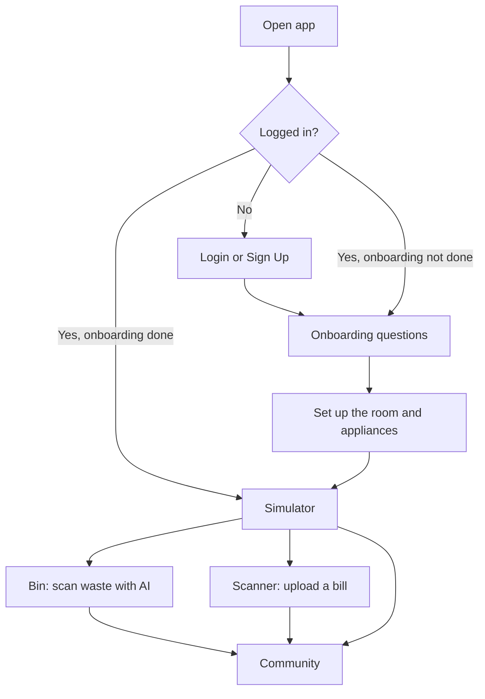

Order for a new user:

1. Sign up or log in (AUTH-01).
2. Answer onboarding questions: schedule, house layout, appliances (ONB-01 to ONB-03).
3. See the room in the Simulator and try swaps (SIM-01 to SIM-04).
4. Scan waste with AI (BIN-01, BIN-02).
5. Scan a bill (SCN-01 to SCN-03).
6. Join the Community: vote, do daily green deeds, grow the Living Leaf (COM-01 to COM-03).

---

## 2. Data Flow Rules

| Part | Role |
|---|---|
| React Native app | Shows screens. Does the bill calculation on the device (SIM-01, SIM-04). Sends and reads data. |
| Supabase Auth | Sign up, login, saved session. |
| Supabase Database | Stores all user data. Row Level Security (RLS): a user can only read and write their own household data. |
| Supabase Storage | Stores bill files (photo or PDF) and waste photos. |
| Supabase Edge Functions | Call the Gemini API (waste sorting, bill reading). The API key is stored as a Supabase secret, never in the app. The model name is one config value, so it can change without an app update. |
| Scheduled job (pg_cron) | Month-start and month-end notifications, and month-end points settlement and reward result. |

Rules:

- The app never talks to Gemini directly. It always goes through an Edge Function.
- Points are written by the database or an Edge Function, never directly by the app. This stops cheating.
- Onboarding saves after each step. The user can leave and come back.
- Simulated swaps ("Try swap") live in app memory only. They are not saved.

**Points rules:**

| Source | Points | When |
|---|---|---|
| Recycling (Bin) | +10 per recyclable item | After the user taps "I threw it". General waste gives 0. |
| Energy saving (Scanner) | +50 | When a real electricity bill is lower than the Simulator estimate for the same month. Once per billing month. |
| Energy-saving action (Simulator) | Not decided | Which action counts and how many points are not decided yet. |

- Each completed task is one **green deed**. A household's first **3 deeds per day** give points (day = Malaysia time). Later deeds that day give 0 points. The Bin still shows the right bin.
- Deeds and points belong to the household. The neighbourhood total is the sum of its households.
- Voting in Community does not use points.

---

## 3. Workflows by Feature

Participants in the diagrams:

- User
- App = React Native app
- Auth = Supabase Auth
- DB = Supabase Database
- Storage = Supabase Storage
- EF = Supabase Edge Function
- AI = Gemini API

### W1. Login and Sign Up (AUTH-01)

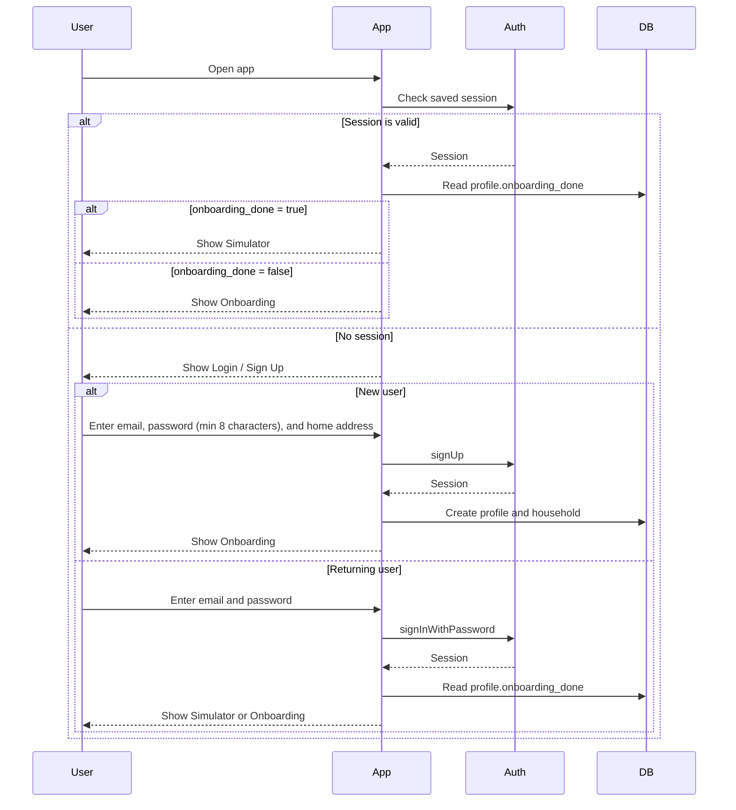

Error cases:

- Wrong password: show a clear message, stay on the login screen.
- Email already used: show a message with a link to log in.
- No internet: show a toast and a retry button.

### W2. Onboarding (ONB-01, ONB-02, ONB-03)

Steps in order: Schedule → House layout → Appliances.

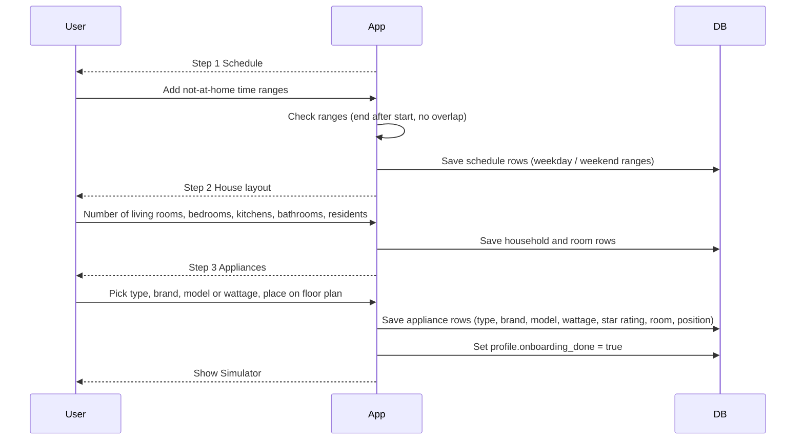

Rules:

- If the range check fails, show an error under the field and do not save.
- If a model is not found, the user types the wattage by hand.
- The star rating is 1 to 5. If the user picks "Not sure", the app saves 3 stars.
- If the user closes the app in the middle, the next login resumes at the first step that is not done.

### W3. Simulator (SIM-01 to SIM-04)

**3a. Open the Simulator and calculate the bill (SIM-01)**

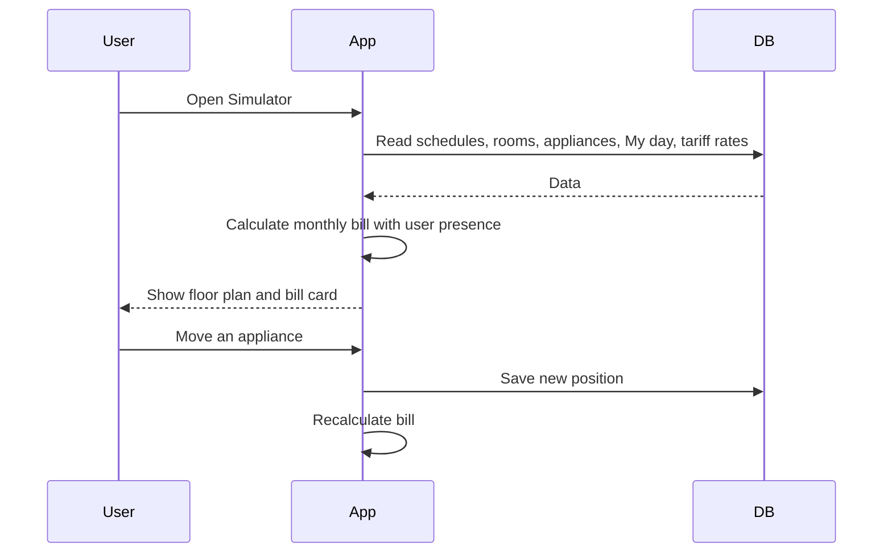

Calculation steps (on the device):

1. Split each day into 30-minute slots. Mark each slot "home" or "away" using the schedule (ONB-01). Weekdays and weekends use their own schedules.
2. For each appliance and each slot, decide on or off:
   - Always-on appliances (fridge, router): on.
   - Any other appliance in an "away" slot: **off**. Presence always wins over My day.
   - Any other appliance in a "home" slot, **before the user answers any My day question**: on. This gives the "max" bill.
   - Any other appliance in a "home" slot, **after My day is saved**: on only if the block active in that slot lists the appliance as on. With no active block, only the living room lights are on, and only when dark (19:00 – 07:00).
3. Water heater (not slot based): kWh per day = showers per person per day × number of residents × minutes per shower ÷ 60 × wattage ÷ 1000. Default: 2 showers per person, 10 minutes.
4. kWh per day = sum of (wattage × hours on ÷ 1000) for all appliances. A month is 30 days (5/7 weekdays, 2/7 weekend days).
5. Convert the monthly kWh to RM with the TNB tariff (generation, capacity, network, retail, AFA). See `Feature_Requirements.md`, Appendix A.
6. A swap (SIM-02) changes the wattage only. Presence and My day stay the same. Swap saving = old monthly bill − new monthly bill.

**3b. Swap & Compare (SIM-02) and Solar suggestion (SIM-03)**

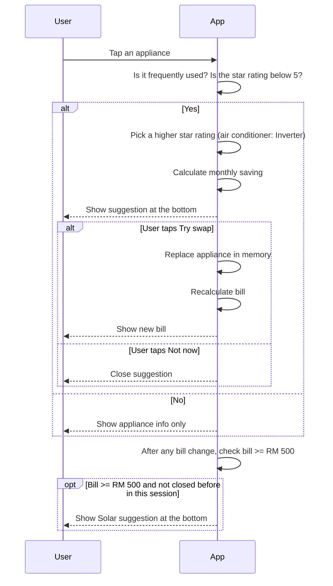

**3c. Time Fast-Forward with animation (SIM-04)**

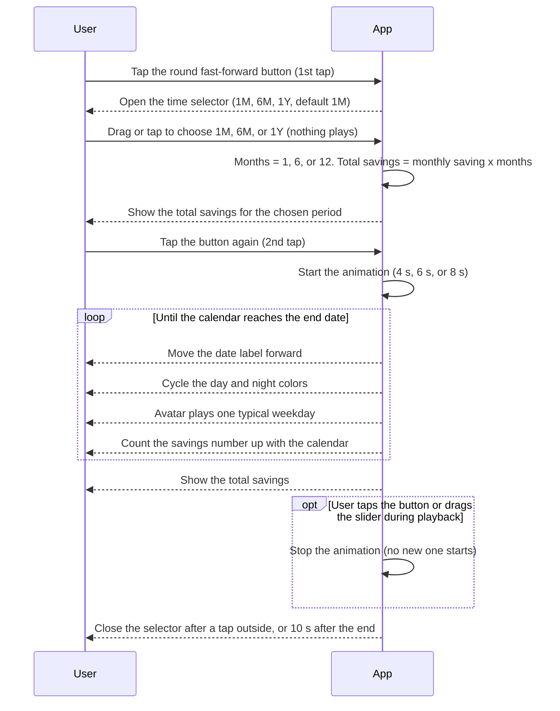

Rules:

- Button states: closed (fast-forward icon), open (play icon), playing (stop icon).
- Letting go of the slider does not start the animation. Only the second tap does.
- The monthly saving is calculated with presence and My day (3a). The animation only shows the number. It never changes it.
- The avatar loop is one typical weekday: leaves, home turns energy-saving, comes back, lights on, goes to bed.
- If "reduce motion" is on, the second tap skips the animation and shows the final date and savings.
- No data is read or written during the animation.

**3d. Avatar follows the schedule (SIM-06)**

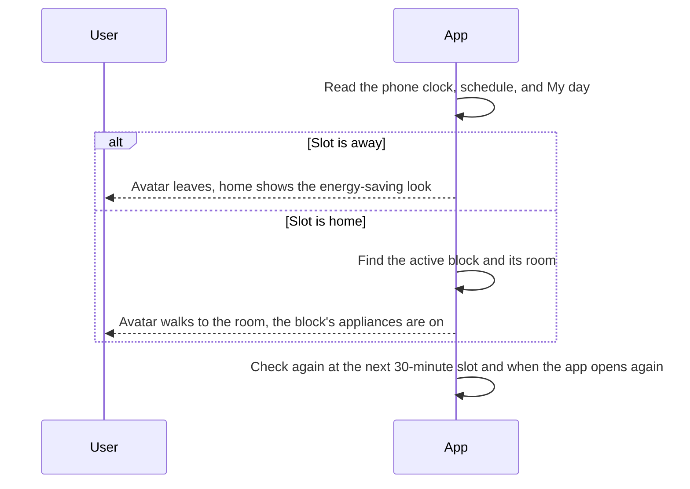

Where the avatar is in a home slot (first match wins):

1. A shower block: bathroom.
2. The block active at that time: its room (sleep: first bedroom, meal: kitchen, evening: living room, work or study: the room the user picked).
3. No block: living room.

Before the user answers any My day question, the default blocks (see 3e) are used only to place the avatar. The bill still uses the max rule.

The active block also decides which appliances are on. This is the same data used in 3a, so the picture and the bill always agree.

**3e. My day: Quick setup and timeline (SIM-07)**

*Quick setup (first time)*

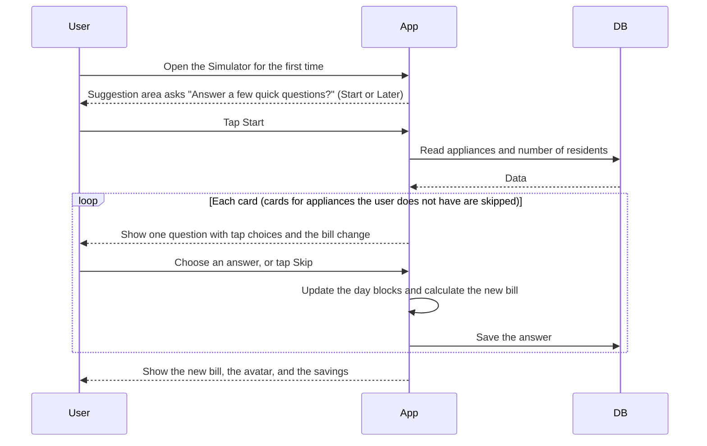

| Card | Question | Choices | Saved as |
|---|---|---|---|
| 1. Sleep | When do you sleep? | Bed time 22:00 / 23:00 / 00:00 / Other. Wake time 06:00 / 07:00 / 08:00 / Other. | Sleep block |
| 2. Sleeping aircon (only with a bedroom air conditioner) | Aircon while you sleep? | No / All night / About 3 hours / About 5 hours. Runs from bed time. With a bedroom fan: "Fan while you sleep?" On / Off. | Appliances on in the sleep block, and how long |
| 3. Evening in the living room | When are you in the living room in the evening? | 19:00 – 22:00 / 20:00 – 23:00 / 21:00 – 24:00 / Not much. With a TV: "Do you watch TV?" Yes / No. With an air conditioner or fan there: switches "Aircon on?" "Fan on?" | Evening block |
| 4. Showers (only with a water heater) | Showers per person per day | Stepper 0 to 4 (default 2) | Showers per person |

*Timeline (any time)*

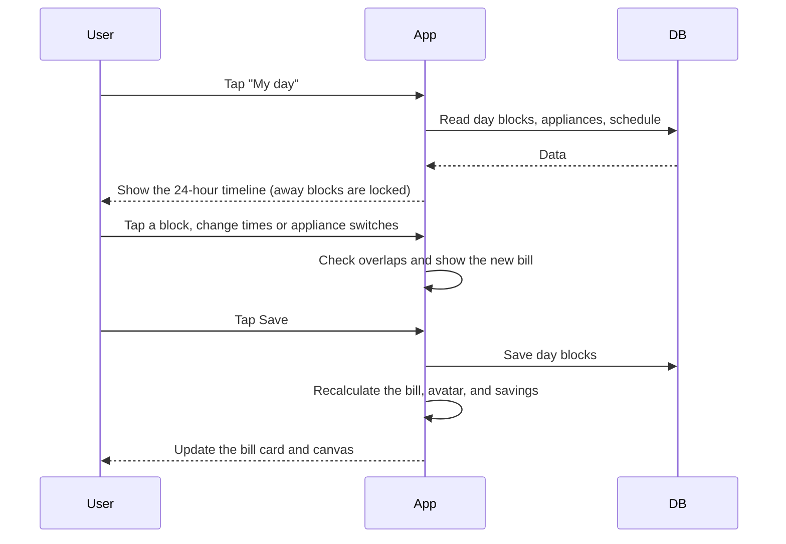

Default blocks (used for skipped cards and "Reset to default"):

| Block | Room | Time | Appliances on |
|---|---|---|---|
| Sleep | All bedrooms (avatar in the first bedroom) | 23:00 – 07:00 | Bedroom air conditioner and fan. Lights off. |
| Breakfast | Kitchen | 07:00 – 07:30 | Kitchen lights |
| Lunch | Kitchen | 12:00 – 12:30 | Kitchen lights |
| Dinner | Kitchen | 19:00 – 19:30 | Kitchen lights |
| Evening | Living room | 20:00 – 23:00 | Lights, TV, air conditioner, fan |
| Showers | Bathroom | 07:15 and 20:30, 10 minutes each | Water heater (counted by the shower formula, not by time) |
| Away | none | From the schedule | Locked. Only always-on appliances run. |

Data saved: each block has a type (sleep, meal, evening, shower, work, other), a room, a start time, an end time, and the appliances that are on. Showers per person and minutes per shower are saved with the household.

Rules:

- Until the user answers at least one question, the bill is the max bill.
- Blocks cannot overlap. Overnight is allowed only for Sleep.
- A block inside an away range is ignored (presence wins), and the app tells the user.
- Only appliances in the block's room are listed as switches.
- The user can add a block (work or study, other) with a room, times, and switches. The user can delete any block except Sleep.
- My day is the same on weekdays and weekends. Only the away blocks change.

### W4. Bin: AI Waste Scanner (BIN-01, BIN-02)

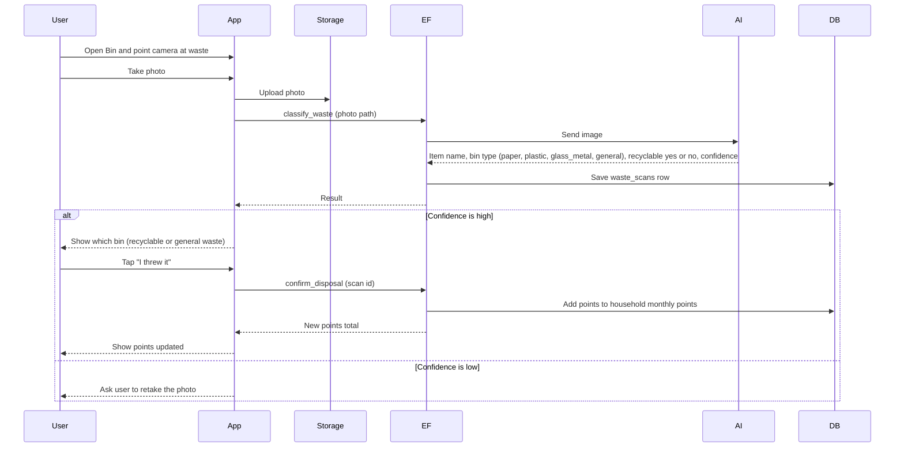

Error cases:

- Camera permission denied: show a message with a button to open settings.
- AI fails or times out: show a retry button.
- Photo not clear: ask the user to retake.

Points rule: +10 points for each recyclable item (paper, plastic, glass and metal). General waste gives 0. The Edge Function adds the points, so the app cannot change them.

### W5. Scanner: Bill Analyzer (SCN-01, SCN-02, SCN-03)

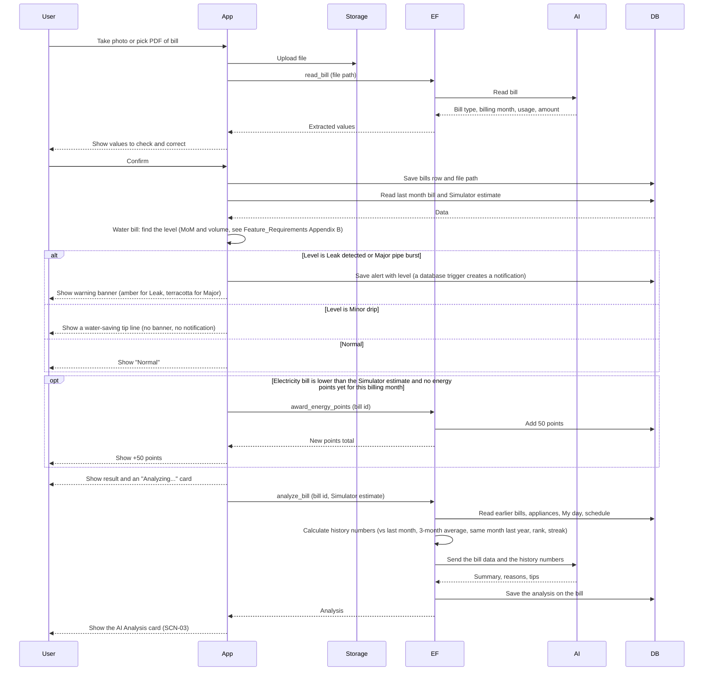

Rules:

- The user always checks and can correct the numbers before saving.
- Saved bills show in the archive list, newest first.
- The first bill has no last month. For electricity, compare only with the Simulator estimate. For water, use only the volume limits.
- Energy points (+50) are given once per billing month, even if the user uploads the same month again.
- The warning level is decided by the app's rules (water: the higher of the MoM level and the volume level, Appendix B). The AI only explains it. The demo case is 18 m³ and +48%: Leak detected.
- The bill amount (RM) is shown but does not decide the level.
- The +50 energy points count as one green deed (COM-03). The Edge Function applies the daily limit of 3 deeds.
- The Edge Function sends the AI only the numbers it needs. The AI must not make up RM amounts or percents. Every number in the text comes from the data sent.
- **History comparison:** The Edge Function calculates the history numbers from the saved bills (change vs last month, difference vs the 3-month average, difference vs the same month last year, rank in the last 6 months, and the up or down streak). The AI only explains them.
- Only bills of earlier months than the new bill are used. Numbers that need more history are left out.
- "Analyze again" on Bill Detail runs the analysis again with the current history (for example after the user adds older bills).
- The analysis is saved in `bills.analysis`. Opening an old bill reads it from there and does not call the AI again.
- The result screen shows the status and warning first. The analysis loads after, so the user never waits for it.
- If the AI fails, the card shows "Try again". The bill is already saved.

### W6. Community (COM-01, COM-02, COM-03)

Households are grouped into a neighbourhood (sector) from the registered address. How sectors are defined is not decided yet.

**6a. View the Community and vote (COM-01)**

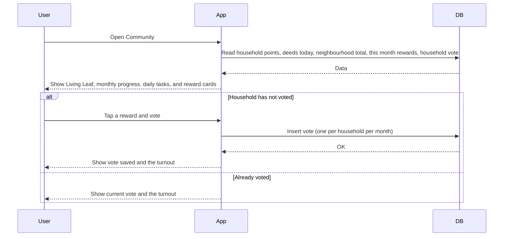

Voting does not use points. Each household has one vote per month.

**6b. Daily green deeds and Living Leaf (COM-03)**

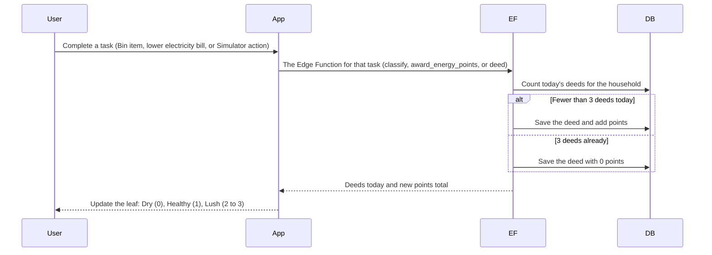

Rules:

- A day runs from midnight to midnight, Malaysia time. The leaf goes back to Dry at midnight.
- The app only shows the numbers. Deeds and points are written by the Edge Function or the database.
- "Recommended for you" lists the tasks. Each one has a button that opens the right screen (Bin, Scanner, Simulator).

**6c. Month-end settlement (COM-02)**

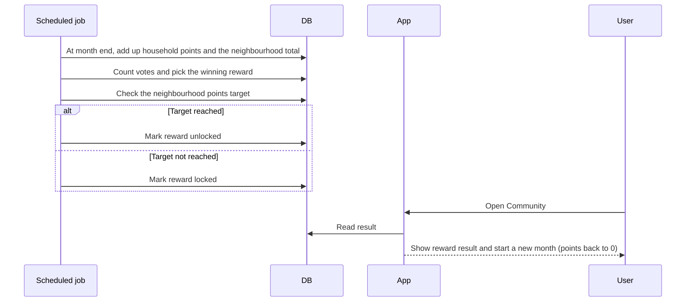

### W7. Notifications (NOT-01)

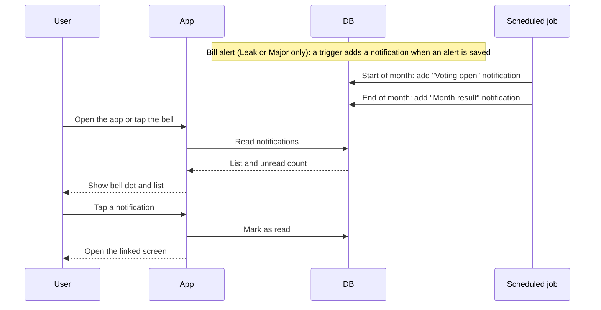

Version 1 is an in-app list only. There are no phone push messages.

---

## 4. Data Summary (Screen → Supabase)

| Screen | Reads | Writes | Other |
|---|---|---|---|
| Login / Sign Up | profile | profile, household | Auth |
| Onboarding | schedules, rooms, appliances | schedules, households, rooms, appliances, profile.onboarding_done | |
| Simulator | schedules, rooms, appliances, day_blocks, tariff_rates | appliances (position, edits), day_blocks, showers per person | Bill, avatar, and animation run in the app |
| Bin | household points | waste_scans, points and deeds | Storage (photo), Edge Function, Gemini |
| Scanner | bills (with analysis), appliances, day_blocks | bills (with analysis), alerts (with level), points and deeds (energy) | Storage (file), Edge Function, Gemini |
| Community | points, deeds (today), rewards, votes, neighbourhood totals | votes | Deeds and points written by Edge Functions. Scheduled job for month end. |
| Notifications | notifications | notifications (read flag) | Database trigger, scheduled job |

Detailed tables and columns go in `Database_Schema.md`.

---

## 5. Open Items

Decided: star rating in ONB-03, points values (+10 recycling, +50 energy saving), voting does not use points, one vote per household per month, up to 3 green deeds per day with Living Leaf stages, Gemini for AI, 2.5D floor plan, TNB tariff (see `Feature_Requirements.md`, Appendix A), water anomaly levels (Appendix B), two-tap fast-forward button, nested mini cards allowed (see `design.md`), no summary numbers row on Profile.

Not decided yet:

1. **Monthly points targets:** How many points unlock the monthly reward for the neighbourhood? Is there also a household milestone, and how many points?
2. **Simulator deed:** Which Simulator action counts as a green deed, how it is checked, and how many points it gives.
3. **Neighbourhood sectors:** How a sector is made from the address, the minimum size, and what happens to a household with no sector.
4. **Daily limit vs recycling:** Version 1 counts only the first 3 deeds of the day for points. Someone who sorts 10 items in a day gets points for 3. Please confirm.
5. **Reward unlock rule:** `Feature_Requirements.md` unlocks on the monthly target only. `screen_spec.md` (6.6) also mentions the Lush state. Please confirm.
6. **Water limits:** Confirm that the volume limits scale with household size (value × residents ÷ 3), and check the Air Selangor tariff before launch.
7. **AFA value:** It changes every month. Someone must update `tariff_rates` each month.
8. **Generation charge above 1,500 kWh:** Sources disagree if the higher rate applies to all kWh or only to the kWh above 1,500. Version 1 uses only the kWh above 1,500.
9. **Gemini model name:** `gemini-2.5-flash` was shut down on 16 October 2026 and returns a 404 error. Use a current Flash model (Google lists `gemini-3.5-flash` as the replacement). Keep the model name in one config value, because Google retires models often.
10. **Solar "See how":** Where does the button go?
11. **Push notifications:** Not in version 1.
12. **One account per household:** Several members sharing one household are not covered.
13. **My day defaults:** Sleep 23:00 – 07:00 with air conditioner and fan on, meals at 07:00 / 12:00 / 19:00 for 30 minutes, evening 20:00 – 23:00 with everything on, 2 showers of 10 minutes per person. Please confirm.
    Also confirm: sleep uses the first bedroom, showers at 07:15 and 20:30 (avatar only), and work or study blocks need a room picked by the user.
14. **One avatar for the household:** Several people with different routines are not shown.
15. **Avatar uses the phone clock:** The user can only see other times of day through the fast-forward animation.
16. **Limit on "Analyze again":** Each run calls Gemini. Should there be a daily limit per user?
